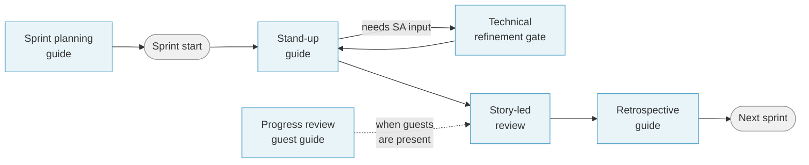

# DDaT Programme Toolkit

**Digital, Data and Technology Delivery -- a practical resource for programme leads in local government**

---

**If you have five minutes:** Pick one guide from the Ways of Working series, pin it in the relevant Teams channel before your next ceremony, and see what changes. The stand-up guide is the fastest win. The technical refinement gate fixes the most expensive recurring problem.

---

This toolkit gives DDaT delivery leads something they rarely get: a coherent set of working materials covering both the digital infrastructure of the programme (how to structure your MS Teams environment) and the human infrastructure (how ceremonies actually run when they work).

It was developed and refined across a live council DDaT programme, sprint by sprint -- used continuously from sprint 2 through sprint 10 across a multi-directorate transformation programme, not designed in advance and documented after. Everything here reflects what worked under real conditions, adapted from what did not.

It is designed for multi-lane DDaT programmes in local councils -- use case pipelines, platform and transformation lanes operating in parallel, with the coordination challenges that come with them.

---

> "Making the transformation-to-platform handoff a named, private channel rather than a meeting is a structural insight. The problem has a physical location now, which changes how teams manage it."
>
> -- Chief Digital Officer, English county council

> "Nothing comparable exists in the public sector DDaT space. Framing it from the guest's perspective addresses the real failure mode of these sessions -- passive audiences performing interest."
>
> -- Public sector tech consultant, LOTI background

---

## How the toolkit fits together

The four Ways of Working guides are not independent documents. They form a system that runs across a sprint cycle.

Sprint planning opens the sprint -- goal agreed first, candidates triaged, board set. The stand-up runs every day. The refinement gate fires when a BA is ready to request SA input. The story-led review closes the sprint. The guest guide shapes how that review runs when directorate leads or stakeholders are in the room. The retrospective closes the cycle and feeds directly into the next planning meeting through its improvement stories.

The [MS Teams structure](teams-structure.md) gives all four guides a named home -- each one is pinned in the channel where it is used, not stored somewhere people have to look for it.

---

## What is inside

### [MS Teams structure](teams-structure.md)
A four-layer Teams environment for a DDaT programme -- Programme Leadership, Transformation Delivery, Platform Delivery, and Comms & Change Enablement. Includes channel descriptions, membership by role, and welcome messages ready to post on day one.

### [Ways of Working series](ways-of-working/)
Four practical guides for the ceremonies and workflows that make a DDaT programme function. Each one is A4-format, ready to pin in the relevant Teams channel.

| Guide | When to use it |
|---|---|
| [Stand-up guide](ways-of-working/01-standup-guide.md) | Every sprint. Five formats to match where the sprint is. |
| [Story-led reviews](ways-of-working/02-story-led-reviews.md) | End of sprint. Show done work, get real feedback. |
| [Technical refinement gate](ways-of-working/03-technical-refinement-gate.md) | Before any SA conversation is requested. |
| [Progress review guest guide](ways-of-working/04-progress-review-guest-guide.md) | When directorate leads or stakeholders attend a review. |
| [Sprint planning guide](ways-of-working/05-sprint-planning-guide.md) | Start of sprint. Six-step sequence from goal to sprint board. |
| [Retrospective guide](ways-of-working/06-retrospective-guide.md) | End of sprint. Five-part format with carry-forward check. |

---

## How to use this

- **Starting from scratch:** Create Teams in the order listed. Copy channel descriptions and welcome messages directly; edit role names to match your team. Pin the Ways of Working guides in the relevant channels before you invite anyone.
- **Adapting an existing programme:** The WoW guides work independently. Start with the one that addresses your current friction -- usually the stand-up (stand-ups become management check-ins), or the technical refinement gate (SA time wasted on under-prepared conversations).
- **Sharing with a team:** The guides are written for the people using them, not the lead setting them up. They can be read cold.
- **Raising questions or contributing:** Raise an issue or open a pull request. These documents improve through practice.

---

## About the author

Kubair Shirazee is an enterprise transformation leader with 20 years of experience across public and private sector programmes. His work focuses on the decision systems -- the governance, accountability, and collaboration patterns -- that determine whether a transformation programme delivers or stalls.

This toolkit came out of a DDaT delivery lead role at a London borough. The guides were written during the programme, not after it.

More at [kubairshirazee.com](https://kubairshirazee.com).

---

## Licence

Licensed under the [Open Government Licence v3.0](https://www.nationalarchives.gov.uk/doc/open-government-licence/version/3/). Free to use and adapt. Attribution appreciated -- link back to this repo or to [kubairshirazee.com](https://kubairshirazee.com).

---

*Authored by Kubair Shirazee, Digital, Data and Technology Delivery Lead*
